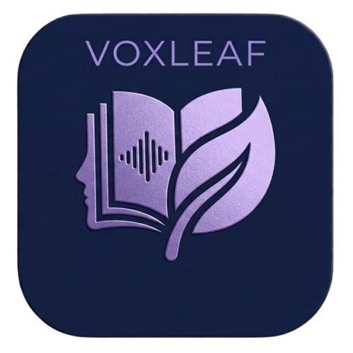

<p align="center">
  
</p>

<h1 align="center">VoxLeaf</h1>

<p align="center">
  <b>Your EPUBs, read and listened to — a fast, fully-local desktop library.</b><br/>
  Built with Rust + Tauri 2 and React. No accounts, no cloud, no Python.
</p>

<p align="center">
  <a href="https://github.com/vivek-502/voxleaf/releases/latest"></a>
  
  
  
</p>

---

VoxLeaf is a self-contained reading and listening library for your own books. Import EPUBs, keep them on a shelf, read them in a built-in reader, and — for any chapter without audio — have it narrated on demand with natural neural voices. Everything lives in a single local SQLite database on your machine.

## Highlights

- 📚 **Library & store** — your shelf with filters (in progress / finished) and sorting, plus discovery through Open Library search with covers; one click adds a book to your library.
- 📖 **EPUB reader** — real EPUB parsing in Rust (spine, TOC, inline images), rendered safely in-app, with reading position synced back to the library and paragraph bookmarks.
- 🔊 **Chapter audio** — upload your own audio per chapter (any format your WebView can play, streamed with HTTP Range support), or generate narration on demand.
- 🗣️ **Native neural TTS** — on-demand chapter narration powered by Microsoft Edge's neural voices, implemented natively in Rust (including the DRM handshake). No Python, no external runtime, works on every platform.
- 🌍 **Chapter translation** — translate any chapter or paragraph into your narration language while reading, streamed live.
- ⏱️ **Real player** — mini + full player, seek, speed, volume, sleep timer, skip intervals, completion threshold, and progress that survives restarts.
- 🎨 **Themes** — dark / light / system, applied before first paint so nothing flashes.
- 🔒 **Fully local** — no account, no telemetry. The only network traffic is store search/covers and optional TTS/translation.

## Install

### Windows

Download **`VoxLeaf_1.0.0_x64-setup.exe`** from the [latest release](https://github.com/vivek-502/voxleaf/releases/latest) and run it. That's it — the installer sets up everything, including the WebView2 runtime if it's missing (it ships with Windows 10/11 already).

Prefer portable? Grab **`VoxLeaf-windows-x64-portable.zip`**, unzip it anywhere, and run `voxleaf.exe`.

### Linux (any distro)

One command — works on Debian, Ubuntu, Fedora, Arch, and everything in between. It downloads the portable build and installs it for your user, no root:

```bash
curl -fsSL https://raw.githubusercontent.com/vivek-502/voxleaf/main/install.sh | bash
```

The script checks your architecture and the WebKitGTK runtime, tells you exactly what's missing if anything is, then installs:

- `~/.local/bin/voxleaf` — the app
- a start-menu entry ("VoxLeaf") in your app menu

Pin a version, or remove it again:

```bash
curl -fsSL https://raw.githubusercontent.com/vivek-502/voxleaf/main/install.sh | bash -s -- 1.0.0
curl -fsSL https://raw.githubusercontent.com/vivek-502/voxleaf/main/install.sh | bash -s -- --uninstall
```

Prefer portable? Grab **`VoxLeaf-linux-x64-portable.zip`** from the [latest release](https://github.com/vivek-502/voxleaf/releases/latest):

```bash
unzip VoxLeaf-linux-x64-portable.zip -d voxleaf
chmod +x voxleaf/voxleaf
./voxleaf/voxleaf
```

The zip contains the binary, the app icon, and an example `.desktop` entry (`voxleaf.desktop`) with install instructions in its header comment, so you can add VoxLeaf to your app menu yourself.

VoxLeaf needs the WebKitGTK 4.1 runtime once per machine:

| Distro | Package |
| --- | --- |
| Debian / Ubuntu | `libwebkit2gtk-4.1-0` |
| Fedora | `webkit2gtk4.1` |
| Arch | `webkit2gtk-4.1` |

## Build from source

Prerequisites:

- **Rust** (stable) — [rustup.rs](https://rustup.rs)
- **Node.js 20+** and npm
- Linux only, the Tauri system deps ([full list here](https://v2.tauri.app/start/prerequisites/)):
  `sudo apt install libwebkit2gtk-4.1-dev build-essential curl wget file libxdo-dev libssl-dev libayatana-appindicator3-dev librsvg2-dev`
- Windows only: Visual Studio Build Tools with the “Desktop development with C++” workload (or MinGW-w64), plus the WebView2 SDK (Tauri fetches it automatically).

```bash
git clone https://github.com/vivek-502/voxleaf.git
cd voxleaf
npm install

npm run tauri dev          # run in dev mode (hot frontend reload)
npm run tauri build        # produce platform installers in target/release/bundle/
```

Useful variants:

```bash
npm run tauri build -- --bundles nsis      # Windows installer only (from Windows/MinGW)
cargo test -p voxleaf-core                 # 220+ Rust tests
npm test                                   # frontend tests
```

Cross-compiling the Windows build from Linux (what this repo's releases are made with):

```bash
rustup target add x86_64-pc-windows-gnu
sudo apt install gcc-mingw-w64-x86-64   # or: pacman -S mingw-w64-gcc
npm run tauri build -- --target x86_64-pc-windows-gnu --bundles nsis
```

(The repo's `.cargo/config.toml` already wires up the MinGW linker; NSIS ≥ 3.08 must be on your `PATH` for the installer step.)

## Where your data lives

Everything is stored locally in one SQLite database plus media files, under the standard app-data directory for the identifier `com.voxleaf.desktop`:

| OS | Path |
| --- | --- |
| Linux | `~/.local/share/com.voxleaf.desktop/` |
| Windows | `%APPDATA%\com.voxleaf.desktop\` |
| macOS | `~/Library/Application Support/com.voxleaf.desktop/` |

Delete the folder to reset. Settings → Data can also wipe the library in-app.

## How it's built

```
├── crates/voxleaf-core     # all domain logic: SQLite store, EPUB parser,
│                           # Open Library client, Edge-TTS client, HTTP API
├── src-tauri/              # thin shell: window + embedded Axum server that
│                           # serves the API and the built React frontend
└── src/                    # React + TypeScript UI (Vite, Tailwind)
```

The Tauri process embeds a local HTTP server (loopback only) that speaks the same `{ data }` / `{ error }` JSON contract and Range-streamed media endpoints a web deployment would use — the UI is fully decoupled from Tauri specifics, and the whole backend is testable headlessly (220+ tests).

## Credits

Store discovery and covers are provided by the wonderful free [Open Library API](https://openlibrary.org/developers/api). TTS uses Microsoft Edge's online neural voices.

Windows releases of VoxLeaf use the SignPath Foundation for code signing. We thank the SignPath Foundation for supporting the distribution of trusted open-source software.

## License

[MIT](LICENSE) — see [LICENSE](LICENSE).
